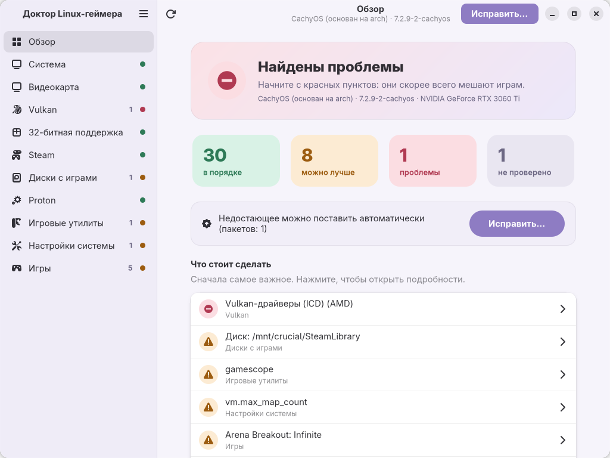
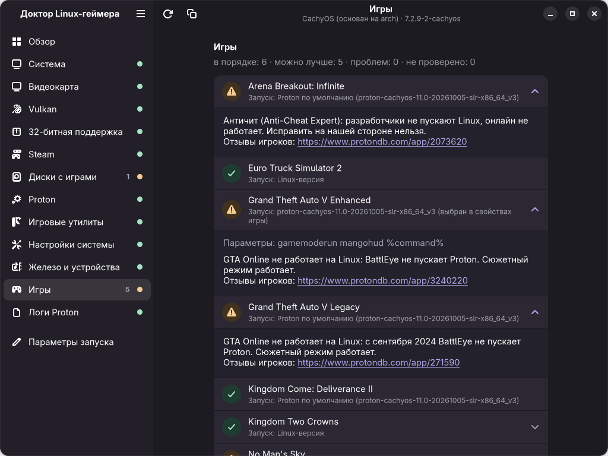
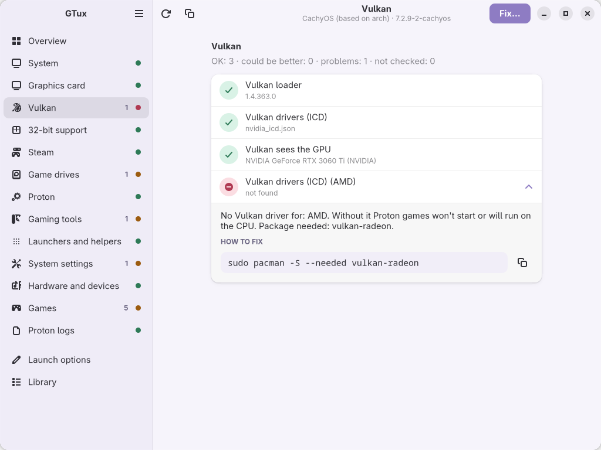
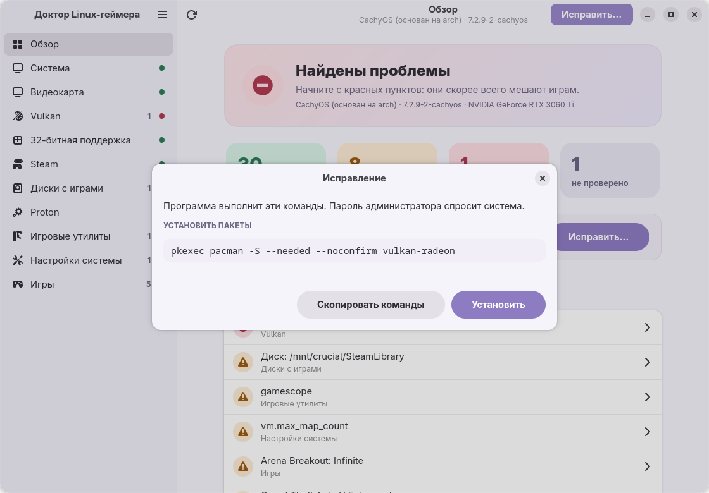

# Доктор Linux-геймера · Linux Gamer Doctor

Проверяет Linux-систему и простым языком объясняет, чего не хватает для игр:
драйвер видеокарты, Vulkan, 32-битные библиотеки, Steam, Proton, диски с играми, системные настройки
и каждую установленную игру (Steam, Heroic, Lutris, Faugus): чем она запускается, нет ли ошибок
в параметрах запуска, пускает ли её античит на Linux.

Интерфейс на русском и английском, есть терминальная версия и окно на GTK4.

| Обзор (светлая тема) | Игры (тёмная тема) |
|---|---|
|  |  |
| **Раздел с проблемой (English)** | **Исправление одной кнопкой** |
|  |  |

На скриншотах с проблемами добавлены демо-данные (`DOCTOR_GUI_DEMO=1`), чтобы были видны все статусы.

**По умолчанию программа ничего не меняет в системе.** Она только читает. Если что-то нужно исправить,
она показывает команду. С флагом `--fix` программа сама предложит поставить недостающие пакеты,
но выполнит команды только после вашего подтверждения.

```
│ ОК          │ Resizable BAR                   │ включён, окно 8 ГБ, видеопамять 8 ГБ                  │
│ МОЖНО ЛУЧШЕ │ Диск: /mnt/crucial/SteamLibrary │ ntfs3 на /dev/nvme1n1p2, свободно 138 ГБ              │
│             │                                 │ Библиотека на NTFS, но префиксы Proton уже вынесены…  │
Итого — ок: 30, можно улучшить: 6, проблем: 0, не проверено: 0
```

## Запуск

Нужен Python 3.11+ и библиотека [rich](https://github.com/Textualize/rich) для красивого вывода.

```bash
# Arch / CachyOS / Manjaro: rich обычно уже стоит, если нет:
sudo pacman -S python-rich

git clone <адрес репозитория> linux-gamer-doctor
cd linux-gamer-doctor
python main.py           # таблица в терминале
python main.py --gui     # графическое окно
python main.py --fix     # то же + предложить установить недостающие пакеты
python main.py --json    # JSON для скриптов, бота, GUI
python main.py --lang en # English
```

Язык по умолчанию берётся из локали системы (`LANG`). В окне язык переключается в меню ☰ и запоминается.

### Графическое окно (`--gui`)

Нужны GTK 4 и libadwaita с PyGObject. На GNOME, как правило, они уже есть:

```bash
sudo pacman -S gtk4 libadwaita python-gobject          # Arch / CachyOS
sudo apt install gir1.2-adw-1 python3-gi               # Debian / Ubuntu
sudo dnf install libadwaita python3-gobject            # Fedora
```

- **Обзор**: общее состояние, счётчики и список «Что стоит сделать» по важности. Нажмите на пункт, чтобы перейти к нему.
- **Разделы**: проверки с пояснениями, командами (кнопка «Скопировать») и ссылками.
- **«Исправить…»**: тот же план, что у `--fix`. Пароль спрашивает системное окно (pkexec), журнал установки показан прямо в диалоге.
- Пастельная тема сама следует за светлой или тёмной темой системы. На узком экране боковая панель сворачивается.

Для проверки права root не нужны. `--fix` вызывает `sudo`, и пароль вы вводите сами.

### Установка недостающего (`--fix`)

1. Программа собирает пакеты, которые предложили проверки с жёлтым или красным статусом.
2. Показывает план: точные команды по шагам.
3. Спрашивает: **д/y**, чтобы выполнить всё, **в/s**, чтобы выбрать пакеты по одному, **Enter** для отмены (это ответ по умолчанию).
4. Выполняет шаги по очереди и останавливается на первой ошибке.

Автоматически только **ставятся пакеты**. На Debian/Ubuntu программа ещё может включить архитектуру i386.
Конфиги (`/etc/pacman.conf`, sysctl, fstab) программа не правит, команды для них только показывает.
Если ввод не из терминала, ничего не выполняется.

## Что проверяется

| Группа | Что смотрим |
|---|---|
| Система | дистрибутив, ядро (≥ 5.16 для fsync в Proton), пакетный менеджер |
| Видеокарта | модель, загруженный драйвер (nvidia / nouveau / amdgpu / radeon / i915 / xe), версия NVIDIA или Mesa, рассинхрон драйвера после обновления без перезагрузки, Resizable BAR |
| Vulkan | загрузчик, ICD-файлы под вашу видеокарту, видит ли `vulkaninfo` настоящую карту, а не llvmpipe |
| 32 бита | включён ли multilib, стоят ли lib32-драйвер и Vulkan, совпадают ли версии NVIDIA 64/32 |
| Steam | способ установки (пакет, flatpak, snap, другое), библиотеки игр и число игр в каждой |
| Диски | NTFS/exFAT под библиотекой, опция `windows_names`, где лежат префиксы Proton (`compatdata`), read-only, `noexec`, «грязный» NTFS-том, свободное место |
| Proton | версии от Valve, сторонние сборки (GE, CachyOS…), есть ли Proton-GE |
| Утилиты | gamemode, MangoHud, gamescope и их 32-битные части |
| Настройки | governor процессора (с учётом intel_pstate/amd-pstate EPP), `vm.max_map_count`, лимит открытых файлов |
| Игры | для каждой игры Steam, Heroic (Epic, GOG, Amazon, свои), Lutris и Faugus: Linux-версия или Proton (и какой), не удалена ли выбранная сборка Proton, ошибки в параметрах запуска (нет `%command%`, не установлен `gamemoderun`/`mangohud`, неверный `WINE_CPU_TOPOLOGY`, переменные Proton у нативной игры), статус античита, требования игры к системе |

### Почему NTFS — частая проблема

Proton создаёт для каждой игры «префикс» (`steamapps/compatdata/<id>`). В префиксе есть
симлинки и файлы с именами вроде `c:`, а ещё ему нужны Linux-права доступа. На NTFS это работает
ненадёжно, а с опцией монтирования `windows_names` не работает вовсе. Последствия: игры не
запускаются и теряются сохранения. Если Windows выключили с «быстрым запуском», NTFS-том
остаётся «грязным», и Linux монтирует его только для чтения.

Что можно сделать: держать игры на ext4/btrfs. Или оставить игры на NTFS, а `compatdata` вынести
на Linux-раздел через симлинк. Программа замечает такой перенос.

### Статусы

| Статус | Значение |
|---|---|
| **ОК** (зелёный) | всё хорошо |
| **МОЖНО ЛУЧШЕ** (жёлтый) | работает, но можно улучшить |
| **ПРОБЛЕМА** (красный) | скорее всего мешает играм |
| **НЕ ПРОВЕРЕНО** (серый) | проверить не удалось, причина показана |

Код выхода: `0`, если проблем нет, `1`, если есть хотя бы одна красная, `2`, если не хватает `rich`.

### Поддержка дистрибутивов

| Семейство | Менеджер | 32 бита |
|---|---|---|
| Arch, CachyOS, Manjaro, EndeavourOS | pacman | репозиторий `[multilib]` |
| Debian, Ubuntu, Mint, Pop!_OS | apt (dpkg) | архитектура `i386` |
| Fedora | dnf (rpm) | пакеты `.i686`, всегда доступны |

На Arch программа проверена на живой системе. На Debian, Ubuntu и Fedora проверены тесты
с имитацией `dpkg-query` и `rpm`, а имена пакетов сверены с документацией
(источники перечислены в `doctor/pkgnames.py`). Если что-то не совпадает с вашей системой, присылайте issue.
Где мы не уверены в имени пакета, мы молчим и не советуем: например, 32-битные части gamemode
и MangoHud проверяем только на Arch.

## Формат JSON

```json
{
  "version": "0.1.0",
  "language": "ru",
  "summary": {"ok": 24, "warn": 1, "fail": 0, "unknown": 0},
  "results": [
    {
      "id": "gpu.driver", "group": "gpu", "title": "Драйвер", "status": "ok",
      "value": "nvidia", "hint": "", "fix": null, "error": null, "packages": []
    }
  ],
  "fix_plan": {"steps": [{"kind": "install", "command": "sudo pacman -S --needed …", "argv": […], "packages": […]}],
               "skipped": [], "skipped_reason": ""}
}
```

`id` и `status` стабильные, на них можно опираться. Тексты (`title`, `value`, `hint`) зависят от языка.

## Для разработчиков

```
main.py                 точка входа, флаги
doctor/
  models.py             CheckResult, Status, Context (общие факты между группами)
  runner.py             запуск проверок; упавшая проверка становится «НЕ ПРОВЕРЕНО»
  system.py             запуск команд с таймаутом, чтение файлов
  packages.py           pacman / apt / dnf: что установлено, команда установки
  pkgnames.py           компонент -> имена пакетов для каждого дистрибутива
  fixer.py              план установки и выполнение (--fix)
  gamedb.py             установленные игры, настройки Steam, базы заметок
  vdf.py                парсер Valve KeyValues (.vdf/.acf)
  data/games.toml       ручные заметки по играм (с источниками)
  data/anticheat.json   снимок AreWeAntiCheatYet (MIT, см. ANTICHEAT_LICENSE.txt)
  i18n/ru.py            все тексты интерфейса
  checks/<группа>.py    проверки, по файлу на группу
  output/               вывод: terminal.py (rich), json_out.py
  launchers.py          игры из Heroic / Lutris / Faugus (форматы взяты из их исходников)
  gui/                  окно: app.py (libadwaita), style.py (пастельная тема), demo.py
  i18n/en.py            английские тексты (тест следит, что ключи совпадают с ru.py)
tests/                  unittest
scripts/                служебные скрипты для разработчиков
docs/screenshots/       скриншоты для README
```

**Скриншоты окна** делаются на невидимом дисплее Broadway, на экран ничего не выводится:

```bash
scripts/gui_screenshots.sh
```

**Обновить базу античитов** перед релизом:

```bash
python scripts/update_anticheat.py
```

**Добавить заметку об игре.** Допишите в `doctor/data/games.toml` раздел `[games.<appid>]`.
Без ссылки на источник в `sources` тест не пройдёт: в базу попадает только то, что подтверждено.

Тесты:

```bash
python -m unittest discover -s tests -t .
```

**Добавить проверку.** Напишите функцию с декоратором `@check("id")` в нужном
`doctor/checks/<группа>.py`, верните `result(GROUP, "id", Status.…, value=…, hint=…, fix=…)`
и добавьте её в `CHECKS`. Тексты кладите в `doctor/i18n/ru.py` с ключом `<группа>.<id>.title` и т.п.

**Добавить язык.** Скопируйте `doctor/i18n/ru.py` в `en.py`, переведите значения и добавьте `"en"`
в `AVAILABLE` в `doctor/i18n/__init__.py`. Язык выбирается флагом `--lang`.

Правила проекта: только стандартная библиотека и `rich`; проверки только читают систему;
ошибки не прячем, а показываем.

## Планы

- Telegram-бот на домашнем сервере
- расширение базы игр
- ярлык в меню приложений (.desktop) и пакет для AUR

## Лицензия

[GNU GPL v3.0 или более поздняя](LICENSE) (GPL-3.0-or-later): программой можно пользоваться,
изменять и распространять её, но изменённые версии тоже должны выходить под GPL с исходным кодом.

Снимок базы `doctor/data/anticheat.json` взят из проекта
[AreWeAntiCheatYet](https://github.com/AreWeAntiCheatYet/AreWeAntiCheatYet) и распространяется
по лицензии MIT (см. `doctor/data/ANTICHEAT_LICENSE.txt`). Она совместима с GPL.

