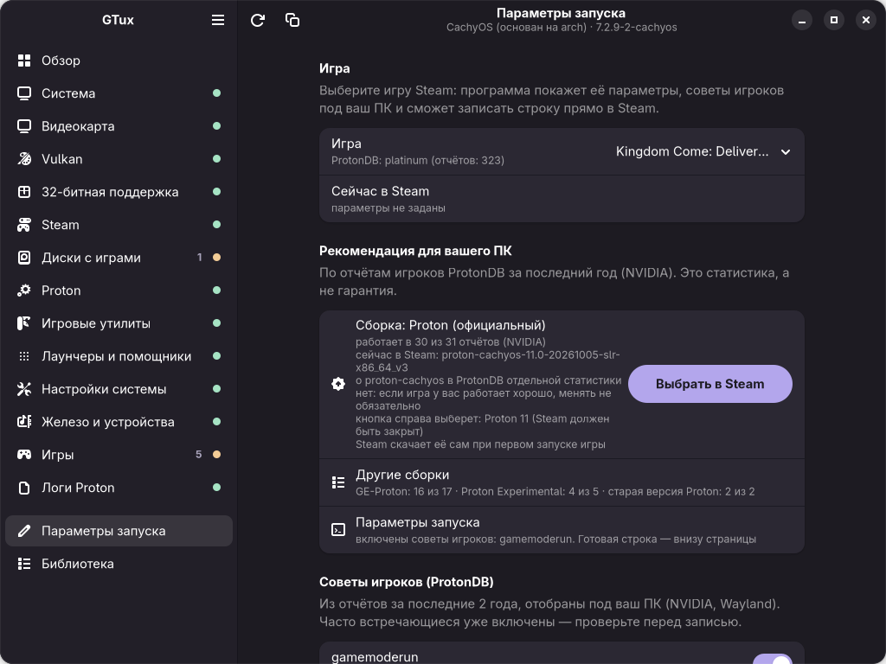
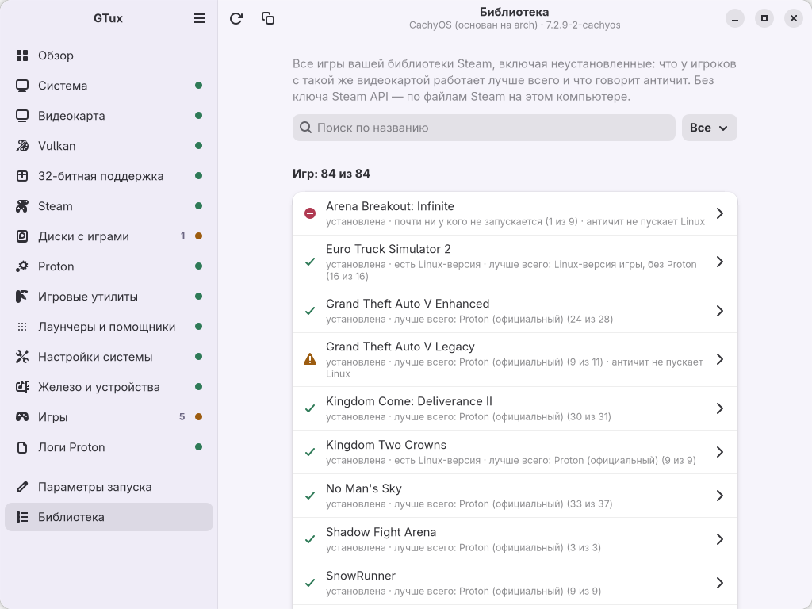

# GTux — доктор Linux-геймера

Проверяет Linux-систему и простым языком объясняет, чего не хватает для игр:
драйвер видеокарты, Vulkan, 32-битные библиотеки, Steam, Proton, диски с играми, системные настройки
и каждую установленную игру (Steam, Heroic, Lutris, Faugus): чем она запускается, нет ли ошибок
в параметрах запуска, пускает ли её античит на Linux.

Интерфейс на русском и английском, есть терминальная версия и окно на GTK4.

| Обзор (светлая тема) | Игры (тёмная тема) |
|---|---|
|  |  |
| **Раздел с проблемой (English)** | **Исправление одной кнопкой** |
|  |  |
| **Параметры запуска: рекомендация под ваш ПК** | **Вся библиотека Steam** |
|  |  |

На скриншотах с проблемами добавлены демо-данные (`GTUX_GUI_DEMO=1`), чтобы были видны все статусы.

**По умолчанию программа ничего не меняет в системе.** Она только читает. Если что-то нужно исправить,
она показывает команду. С флагом `--fix` (или кнопкой «Исправить…» в окне) программа сама предложит
исправить то, что умеет, но выполнит команды только после вашего подтверждения.
Параметры запуска игр Steam меняются только по кнопке «Записать в Steam», а интернет нужен только
для «Обновить базу знаний».

```
│ ОК          │ Resizable BAR                   │ включён, окно 8 ГБ, видеопамять 8 ГБ                  │
│ МОЖНО ЛУЧШЕ │ Диск: /mnt/crucial/SteamLibrary │ ntfs3 на /dev/nvme1n1p2, свободно 138 ГБ              │
│             │                                 │ Библиотека на NTFS, но префиксы Proton уже вынесены…  │
Итого — ок: 30, можно улучшить: 6, проблем: 0, не проверено: 0
```

## Установка

**Arch / CachyOS / Manjaro**: собрать пакет pacman из исходников (sudo нужен только для установки):

```bash
git clone https://github.com/Ms0Skrin/GTux.git gtux && cd gtux
scripts/build_arch_package.sh                      # -> dist/gtux-<версия>-1-any.pkg.tar.zst
sudo pacman -U dist/gtux-*.pkg.tar.zst
gtux --gui
```

Удаление: `sudo pacman -R gtux`. История и журнал остаются в `~/.local/state/gtux/`.
До версии 0.5.0 программа называлась `linux-gamer-doctor`: пакет `gtux` заменяет старый, а папки с историей
и базой знаний при первом запуске переезжают на новое место сами.

**Другие дистрибутивы**: через [pipx](https://pipx.pypa.io/):

```bash
pipx install --system-site-packages .   # system-site-packages — чтобы окно видело системный PyGObject
```

Можно и без установки: `python main.py` из папки проекта.

## Запуск

Нужен Python 3.11+ и библиотека [rich](https://github.com/Textualize/rich) для красивого вывода.

```bash
# Arch / CachyOS / Manjaro: rich обычно уже стоит, если нет:
sudo pacman -S python-rich

git clone https://github.com/Ms0Skrin/GTux.git gtux
cd gtux
python main.py           # таблица в терминале
python main.py --gui     # графическое окно
python main.py --fix     # то же + предложить исправить автоматически
python main.py --update-kb # скачать базу знаний ProtonDB (советы по параметрам)
python main.py --install-ge ~/.local/share/Steam/compatibilitytools.d  # свежий GE-Proton
python main.py --library   # вся библиотека Steam с оценкой под ваш ПК
python main.py --setup     # подготовить всё для игр (--fix + лаунчеры, GE-Proton, multilib)
python main.py --json    # JSON для скриптов, бота, GUI
python main.py --report  # отчёт в Markdown, чтобы вставить на форум
python main.py --lang en # English
python main.py --debug   # подробный журнал в терминал
```

Язык по умолчанию берётся из локали системы (`LANG`). В окне язык переключается в меню ☰ и запоминается.

### Графическое окно (`--gui`)

Нужны GTK 4 и libadwaita с PyGObject. На GNOME, как правило, они уже есть:

```bash
sudo pacman -S gtk4 libadwaita python-gobject          # Arch / CachyOS
sudo apt install gir1.2-adw-1 python3-gi               # Debian / Ubuntu
sudo dnf install libadwaita python3-gobject            # Fedora
```

- **Обзор**: общее состояние, счётчики и список «Что стоит сделать» по важности. Нажмите на пункт, чтобы перейти к нему.
- **Разделы**: проверки с пояснениями, командами (кнопка «Скопировать») и ссылками.
- **«Исправить…»**: тот же план, что у `--fix`. Пароль спрашивает системное окно (pkexec), журнал установки показан прямо в диалоге.
- Пастельная тема сама следует за светлой или тёмной темой системы. На узком экране боковая панель сворачивается.

Для проверки права root не нужны. `--fix` вызывает `sudo`, и пароль вы вводите сами.

### История, отчёт и журнал

- **История.** Каждая проверка сохраняется в `~/.local/state/gtux/history/`
  (хранятся последние 30). В следующий раз программа покажет, **что изменилось**: новое ядро,
  драйвер, исправленные или новые проблемы. Флаг `--no-history` отключает сохранение.
- **Отчёт для форума**: `--report` или кнопка с иконкой копирования в окне. Получается Markdown
  со сводкой системы и проблемами, домашняя папка в нём заменена на `~`.
- **Отладочный журнал**: `~/.local/state/gtux/gtux.log` (до 1 МБ, плюс 3 старые копии).
  В нём запуски, длительность каждой проверки, вызванные команды с кодами возврата и полные
  трассировки ошибок, в том числе из окна. **Если нашли баг, приложите этот файл.** Он есть только
  у вас на компьютере. В окне его можно открыть через меню ☰ → «Открыть журнал».

### Параметры запуска (в окне)

Страница «Параметры запуска» собирает строку для Steam из переключателей: GameMode, MangoHud, gamescope
(с разрешением, MangoHud тогда включается через `--mangoapp`), счётчик FPS DXVK, журнал Proton,
отключение fsync/esync, WineD3D, ограничение ядер (`WINE_CPU_TOPOLOGY`), аргументы игры.
Готовая строка сразу проверяется той же проверкой, что и параметры ваших игр.

Если выбрать игру Steam:
- переключатели выставляются по её текущим параметрам, а остальное из них показывается отдельными
  переключателями: можно оставить или убрать;
- блок **«Рекомендация для вашего ПК»**: какая сборка (официальный Proton, Experimental, GE-Proton,
  старая версия или Linux-версия игры) чаще всего работает у игроков с такой же видеокартой, сколько это
  отчётов, выбрана ли она уже, установлена ли; кнопка **«Выбрать в Steam»** записывает её в свойства игры
  (`config/config.vdf`, раздел `CompatToolMapping`, как это делает сам Steam) — тоже только при закрытом
  Steam, с копией файла и кнопкой «Вернуть как было»; остальные сборки — со счётом;
- появляются **советы игроков** из базы знаний ProtonDB, подобранные под ваш ПК (см. ниже);
- кнопка **«Записать в Steam»** меняет параметры игры в `userdata/<id>/config/localconfig.vdf`.
  Steam при этом должен быть закрыт: он держит настройки в памяти и при выходе перезаписал бы файл.
  Меняется только строка `LaunchOptions` этой игры. Копия файла сохраняется в
  `~/.local/state/gtux/backups/`, а **«Вернуть как было»** возвращает прежние параметры.
- Строки с командами оболочки (`bash -c`, `;`, `|`, `$(...)`) и неизвестными программами программа
  не меняет: их нужно править вручную.

### База знаний (`--update-kb` или меню → «Обновить базу знаний»)

Интернет нужен только здесь и только по команде пользователя. Программа скачивает:
- выгрузку отчётов игроков [ProtonDB](https://github.com/bdefore/protondb-data) (около 70 МБ,
  обновляется раз в месяц; при обрыве связи скачивание продолжается с места остановки);
- оценки ваших установленных игр с protondb.com (неофициальный API).

Из отчётов за последние 2 года берутся параметры запуска, и считается, как часто их используют
владельцы видеокарт того же производителя (NVIDIA / AMD / Intel). Советы подбираются под ваш ПК:
- переменные только для NVIDIA или только для AMD показываются только на подходящей видеокарте;
  переменные для Wayland — только в сеансе Wayland;
- переменные, которые работают только в GE-Proton или proton-cachyos, помечаются, если игра запускается другой сборкой;
- советуется только то, что есть в **белом списке**: переменные, описанные в документации Proton,
  GE-Proton, VKD3D-Proton, Wine и PipeWire, обёртки `gamemoderun` и `game-performance` (CachyOS),
  простые аргументы игры вида `-novid`. Строку из чужого отчёта программа никогда не выполняет как есть.

Для выбора сборки Proton берутся отчёты за последний год: на какой сборке играл игрок (поле `variant`)
и заработала ли игра. Если отчётов с такой же видеокартой хотя бы 5, считаются только они. Сборки
сравниваются по нижней границе доли «заработало» (интервал Уилсона), чтобы 3 из 3 не перевешивали 30 из 31;
из почти равных выбирается самая простая (Linux-версия, затем официальный Proton). proton-cachyos
в ProtonDB отдельно не учитывается — программа так и пишет. Это статистика, а не гарантия.

Результат лежит в `~/.cache/gtux/knowledge.json`, проверки читают только его.
Данные отчётов: ProtonDB, лицензия [ODbL](https://opendatacommons.org/licenses/odbl/).

### Библиотека (страница «Библиотека» или `--library`)

Все игры вашей библиотеки Steam, включая неустановленные, — без ключа Steam API: список берётся из
`appcache/librarycache` и `localconfig.vdf`, названия, тип и ОС — из `appcache/appinfo.vdf`. Для каждой игры:
есть ли Linux-версия, какая сборка лучше всего работает у игроков с такой же видеокартой (база знаний ProtonDB),
что говорит античит. Установленную игру можно открыть на странице «Параметры запуска».

### Подготовить всё для игр (`--setup`, кнопка при первом запуске и в меню)

То же, что «Исправить…», но сразу отмечены и полезные пункты «по желанию»: включение multilib, Lutris,
protontricks, Heroic, Faugus, GE-Proton. Не отмечаются полное обновление системы и protontricks для
конкретной игры. Всё видно списком, лишнее можно снять.

### Исправление одной кнопкой (`--fix` или «Исправить…» в окне)

1. Программа собирает то, что можно исправить автоматически: недостающие пакеты, настройки ядра
   (`vm.max_map_count`, `split_lock` в `/etc/sysctl.d/`), доступ Flatpak-Steam к папкам с играми.
2. Показывает план: точные команды по шагам. В окне — с галочками.
3. В терминале спрашивает: **д/y**, чтобы выполнить всё, **в/s**, чтобы выбрать по одному, **Enter** для отмены (это ответ по умолчанию).
   В окне пароль администратора спрашивается один раз на все шаги.
4. Выполняет шаги по очереди, останавливается на первой ошибке и после успеха проверяет систему заново.

**По желанию.** Отдельно, с **снятыми** галочками (в терминале — только при выборе по одному),
программа предлагает то, без чего можно жить:
- **Lutris** и **protontricks** — пакетом вашего дистрибутива (есть в Arch, Debian 13, Ubuntu 26.04, Fedora);
- **Heroic** и **Faugus** — с Flathub для вашего пользователя (`flatpak install --user`, без пароля);
  если flatpak не установлен, он ставится тем же шагом;
- **GE-Proton**, если его нет: программа сама скачивает последний релиз с GitHub, сверяет SHA-512
  с файлом из релиза и распаковывает в `compatibilitytools.d` вашего Steam (без пароля). После этого
  перезапустите Steam.

Имена пакетов сверены с репозиториями 2026-10-26; пакеты RPM Fusion (Fedora: Steam, драйвер NVIDIA) —
по документации RPM Fusion. На Arch `steam` и `steam-devices` лежат в multilib: без него программа
их не ставит и объясняет, как включить. На Debian/Ubuntu перед `steam-installer` включается i386.

`/etc/pacman.conf`, fstab и параметры ядра программа не правит, команды для них только показывает.
Если ввод не из терминала, ничего не выполняется.

**Нет в репозиториях.** Перед установкой GTux сверяет пакеты с подключёнными репозиториями (только локальные
списки: `pacman -Si`, `apt-cache policy`, `dnf -C repoquery`). Чего нет — не попадает в команду (иначе apt/dnf отказались
бы ставить всё) и выносится в подсказку, какой репозиторий включить: contrib/non-free в Debian, universe/multiverse
в Ubuntu, RPM Fusion в Fedora. Lutris и protontricks в этом случае предлагаются с Flathub.

**Проверка в других дистрибутивах**: `scripts/distro_test.sh` запускает тесты и GTux в контейнерах Debian 13,
Ubuntu 26.04 и Fedora (podman, без root) и печатает, что программа распознала и что предложила бы исправить.

## Что проверяется

| Группа | Что смотрим |
|---|---|
| Система | дистрибутив, ядро (≥ 5.16 для fsync в Proton), пакетный менеджер |
| Видеокарта | модель, загруженный драйвер (nvidia / nouveau / amdgpu / radeon / i915 / xe), версия NVIDIA или Mesa, рассинхрон драйвера после обновления без перезагрузки, `nvidia_drm.modeset`, Resizable BAR |
| Vulkan | загрузчик, ICD-файлы под вашу видеокарту, видит ли `vulkaninfo` настоящую карту, а не llvmpipe |
| 32 бита | включён ли multilib, стоят ли lib32-драйвер и Vulkan, совпадают ли версии NVIDIA 64/32 |
| Steam | способ установки (пакет, flatpak, snap, другое), библиотеки игр и число игр в каждой, доступ Steam из Flatpak к библиотекам на других дисках |
| Диски | NTFS/exFAT под библиотекой, опция `windows_names`, где лежат префиксы Proton (`compatdata`), read-only, `noexec`, «грязный» NTFS-том, HDD или SSD, свободное место |
| Proton | версии от Valve, сторонние сборки (GE, CachyOS…), есть ли Proton-GE |
| Утилиты | gamemode, MangoHud, gamescope и их 32-битные части |
| Лаунчеры и помощники | Heroic, Lutris, Faugus, protontricks: установлены ли (пакетом или Flatpak); если нет — предложение «по желанию» |
| Настройки | governor процессора (с учётом intel_pstate/amd-pstate EPP), `vm.max_map_count`, лимит открытых файлов, `split_lock_mitigate` |
| Железо | память и swap/zram, звуковой сервер (PipeWire + pipewire-pulse или PulseAudio), udev-правила для геймпадов |
| Игры | для каждой игры Steam, Heroic (Epic, GOG, Amazon, свои), Lutris и Faugus: Linux-версия или Proton (и какой), не удалена ли выбранная сборка Proton, ошибки в параметрах запуска (нет `%command%`, не установлен `gamemoderun`/`mangohud`, неверный `WINE_CPU_TOPOLOGY`, переменные Proton у нативной игры), статус античита, требования игры к системе |
| Логи Proton | `~/steam-<appid>.log`: недостающие DLL Windows (с командой protontricks), падение внутри Wine, сброс видеокарты (`VK_ERROR_DEVICE_LOST`), повреждённый префикс |

### Почему NTFS — частая проблема

Proton создаёт для каждой игры «префикс» (`steamapps/compatdata/<id>`). В префиксе есть
симлинки и файлы с именами вроде `c:`, а ещё ему нужны Linux-права доступа. На NTFS это работает
ненадёжно, а с опцией монтирования `windows_names` не работает вовсе. Последствия: игры не
запускаются и теряются сохранения. Если Windows выключили с «быстрым запуском», NTFS-том
остаётся «грязным», и Linux монтирует его только для чтения.

Что можно сделать: держать игры на ext4/btrfs. Или оставить игры на NTFS, а `compatdata` вынести
на Linux-раздел через симлинк. Программа замечает такой перенос.

### Статусы

| Статус | Значение |
|---|---|
| **ОК** (зелёный) | всё хорошо |
| **МОЖНО ЛУЧШЕ** (жёлтый) | работает, но можно улучшить |
| **ПРОБЛЕМА** (красный) | скорее всего мешает играм |
| **НЕ ПРОВЕРЕНО** (серый) | проверить не удалось, причина показана |

Код выхода: `0`, если проблем нет, `1`, если есть хотя бы одна красная, `2`, если не хватает `rich`.

### Поддержка дистрибутивов

| Семейство | Менеджер | 32 бита |
|---|---|---|
| Arch, CachyOS, Manjaro, EndeavourOS | pacman | репозиторий `[multilib]` |
| Debian, Ubuntu, Mint, Pop!_OS | apt (dpkg) | архитектура `i386` |
| Fedora | dnf (rpm) | пакеты `.i686`, всегда доступны |

На Arch программа проверена на живой системе. На Debian, Ubuntu и Fedora проверены тесты
с имитацией `dpkg-query` и `rpm`, а имена пакетов сверены с документацией
(источники перечислены в `gtux/pkgnames.py`). Если что-то не совпадает с вашей системой, присылайте issue.
Где мы не уверены в имени пакета, мы молчим и не советуем: например, 32-битные части gamemode
и MangoHud проверяем только на Arch.

## Формат JSON

```json
{
  "version": "0.1.0",
  "language": "ru",
  "summary": {"ok": 24, "warn": 1, "fail": 0, "unknown": 0},
  "results": [
    {
      "id": "gpu.driver", "group": "gpu", "title": "Драйвер", "status": "ok",
      "value": "nvidia", "hint": "", "fix": null, "error": null, "packages": []
    }
  ],
  "fix_plan": {"steps": [{"kind": "install", "command": "sudo pacman -S --needed …", "argv": […], "packages": […]}],
               "skipped": [], "skipped_reason": ""}
}
```

`id` и `status` стабильные, на них можно опираться. Тексты (`title`, `value`, `hint`) зависят от языка.

## Для разработчиков

```
main.py                 точка входа, флаги
gtux/
  models.py             CheckResult, Status, Context (общие факты между группами)
  runner.py             запуск проверок; упавшая проверка становится «НЕ ПРОВЕРЕНО»
  system.py             запуск команд с таймаутом, чтение файлов
  packages.py           pacman / apt / dnf: что установлено, команда установки
  pkgnames.py           компонент -> имена пакетов для каждого дистрибутива
  fixer.py              план исправления и выполнение (--fix), пункты «по желанию»
  geproton.py           установка GE-Proton с GitHub (проверка SHA-512, безопасная распаковка)
  steamcfg.py           запись параметров запуска в localconfig.vdf (копия, журнал, откат)
  knowledge.py          база знаний ProtonDB: скачивание, белый список, личные советы
  gamedb.py             установленные игры, настройки Steam, базы заметок
  vdf.py                парсер Valve KeyValues (.vdf/.acf)
  data/games.toml       ручные заметки по играм (с источниками)
  data/anticheat.json   снимок AreWeAntiCheatYet (MIT, см. ANTICHEAT_LICENSE.txt)
  i18n/ru.py            все тексты интерфейса
  checks/<группа>.py    проверки, по файлу на группу
  output/               вывод: terminal.py (rich), json_out.py
  launchers.py          игры из Heroic / Lutris / Faugus (форматы взяты из их исходников)
  launchopts.py         конструктор параметров запуска, разбор и слияние строк
  library.py            вся библиотека Steam: appinfo.vdf (двоичный v28/v29), librarycache, сводка по игре
  history.py            история проверок и «что изменилось»
  log.py                отладочный журнал
  paths.py              папки программы (XDG), переезд со старого имени linux-gamer-doctor
  gui/                  окно: app.py (libadwaita), style.py (пастельная тема), demo.py
  i18n/en.py            английские тексты (тест следит, что ключи совпадают с ru.py)
tests/                  unittest
scripts/                служебные скрипты для разработчиков
docs/screenshots/       скриншоты для README
```

**Скриншоты окна** делаются на невидимом дисплее Broadway, на экран ничего не выводится:

```bash
scripts/gui_screenshots.sh
```

**Обновить базу античитов** перед релизом:

```bash
python scripts/update_anticheat.py
```

**Добавить заметку об игре.** Допишите в `gtux/data/games.toml` раздел `[games.<appid>]`.
Без ссылки на источник в `sources` тест не пройдёт: в базу попадает только то, что подтверждено.

Тесты:

```bash
python -m unittest discover -s tests -t .
```

**Добавить проверку.** Напишите функцию с декоратором `@check("id")` в нужном
`gtux/checks/<группа>.py`, верните `result(GROUP, "id", Status.…, value=…, hint=…, fix=…)`
и добавьте её в `CHECKS`. Тексты кладите в `gtux/i18n/ru.py` с ключом `<группа>.<id>.title` и т.п.

**Добавить язык.** Скопируйте `gtux/i18n/ru.py` в `en.py`, переведите значения и добавьте `"en"`
в `AVAILABLE` в `gtux/i18n/__init__.py`. Язык выбирается флагом `--lang`.

Правила проекта: только стандартная библиотека и `rich`; проверки только читают систему;
ошибки не прячем, а показываем.

## Планы

- Telegram-бот на домашнем сервере
- расширение базы игр
- ярлык в меню приложений (.desktop) и пакет для AUR

## Лицензия

[GNU GPL v3.0 или более поздняя](LICENSE) (GPL-3.0-or-later): программой можно пользоваться,
изменять и распространять её, но изменённые версии тоже должны выходить под GPL с исходным кодом.

Снимок базы `gtux/data/anticheat.json` взят из проекта
[AreWeAntiCheatYet](https://github.com/AreWeAntiCheatYet/AreWeAntiCheatYet) и распространяется
по лицензии MIT (см. `gtux/data/ANTICHEAT_LICENSE.txt`). Она совместима с GPL.

База знаний (`~/.cache/gtux/knowledge.json`) строится на вашем компьютере из отчётов
ProtonDB, которые распространяются по лицензии Open Database License (ODbL); программа её не распространяет.
